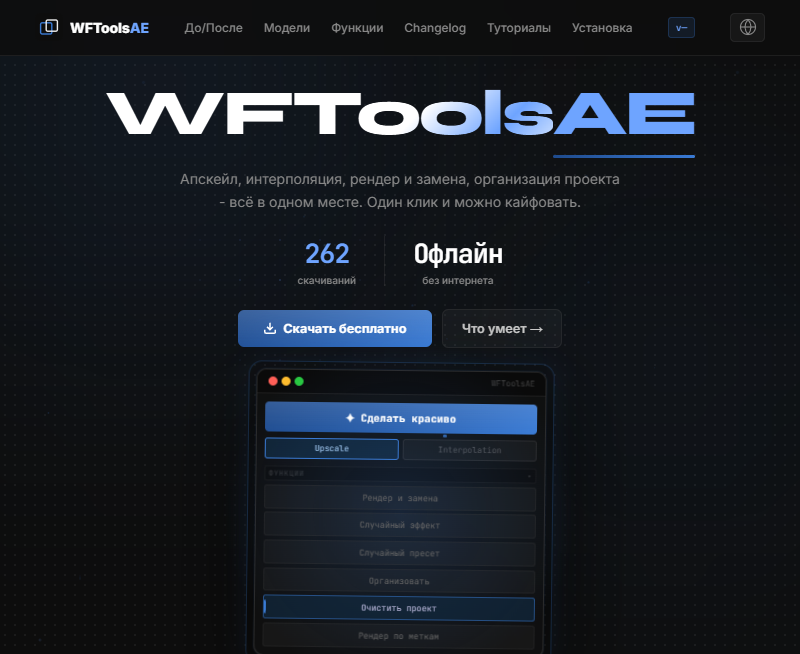
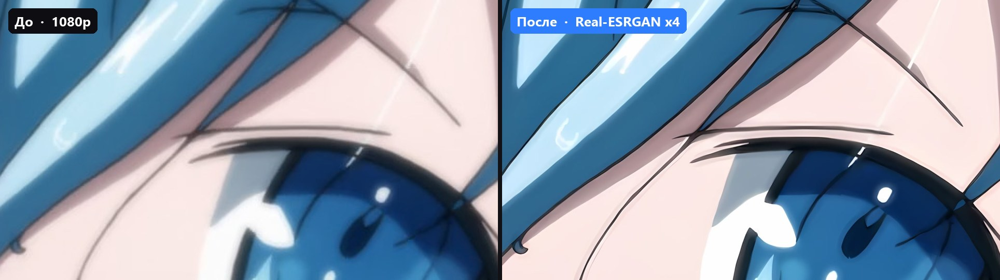
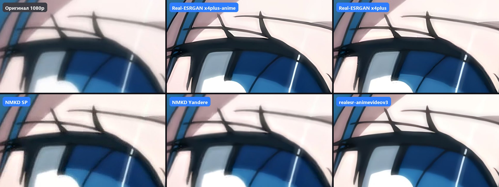

# WFToolsAE

**Расширение для Adobe After Effects: апскейл, интерполяция, рендер и организация проекта — всё в одной панели.**

Официальный сайт: **[wftoolsae.ru](https://wftoolsae.ru)** · Автор: **[@whatforiam](https://youtube.com/@whatforiam)**

---

## Что это

**WFToolsAE** — это панель-расширение (CEP) для After Effects на Windows. Оно живёт внутри AE и добавляет в него то, чего в нём из коробки нет: нейросетевой апскейл **Real-ESRGAN**, интерполяцию кадров **RIFE**, умный рендер и замену слоёв, случайные эффекты и пресеты, организацию и очистку проекта.

Всё считается **локально на твоей видеокарте** — без облаков, без очередей, без интернета.

Файлы релизов в этом репозитории — **официальные установщики**, которые также доступны на [wftoolsae.ru](https://wftoolsae.ru).

## До / После

Перетащи ползунок на сайте или посмотри сюда: слева оригинал 1080p, справа апскейл x4.

## Модели апскейла

На выбор 9 моделей — под аниме, под фото, под что угодно. Переключаются прямо в панели.

## Возможности

| | |
|---|---|
| ✨ **Сделать красиво** | Выделяешь слои — автоматически создаётся прекомп, пресет, апскейл и интерполяция, результат встаёт на таймлайн. Один клик. |
| 🎬 **Рендер и замена** | Три режима: замена слоя в одном месте, во всём проекте, либо рендер по меткам пачкой. |
| 🎲 **Случайный эффект / пресет** | Случайные эффекты AE или случайный `.ffx` из твоих папок, с белым/чёрным списком и кнопкой «переброса» без потери undo. |
| 🗂 **Организатор** | Раскладывает футаж по папкам: Compositions, Videos, Images, Audio, Solids, Image Sequences. |
| 🧹 **Очистка проекта** | Удаляет неиспользуемые композиции и футаж рекурсивным обходом зависимостей. |
| 🏷 **Рендер по меткам** | Помечаешь слои — одной командой рендерится вся пачка композиций по шаблону. |
| 📦 **Сжатие проекта** | Собирает все файлы в одну папку и перекодирует медиа через NVENC / AMF / QSV / x265 (HEVC). |
| ⚡ **Быстрые инструменты** | Открыть проект из панели, дублировать композицию, размытие в движении на всё, импорт готовых пресетов и просмотрщик ассетов. |

## Установка

1. Скачай установщик в [Releases](https://github.com/whatforiam/WFToolsAE/releases) (или с [сайта](https://wftoolsae.ru)) — **`WFToolsAE_Installer.exe`**.
2. Запусти его и следуй шагам (нужны права администратора).
3. Открой After Effects.
4. `Window → Extensions → WFToolsAE`

Обновления расширение подхватывает само: при запуске проверяет версию и предлагает обновиться.

**Требования:** Windows 10/11 · After Effects CC 2015 и новее · любая современная видеокарта (NVIDIA / AMD / Intel) с поддержкой Vulkan.

## Про установщик и «Windows SmartScreen»

> Установщик не подписан коммерческим сертификатом, поэтому Windows может показать синее окно **«Неизвестное приложение»** / **«Защищённый Windows»**. Это стандартное предупреждение для программ без купленной подписи, а не признак вредоносного ПО.
>
> Что делать: **«Ещё информация» → «Всё равно запустить»**.
>
> Установщик — обычная сборка [Inno Setup](https://jrsoftware.org/isinfo.php): он распаковывает файлы расширения в `%APPDATA%\Adobe\CEP\extensions\WFToolsAE` и больше ничего не делает. Никакой телеметрии, трекеров и фоновых служб — расширение полностью работает офлайн.

## FAQ

**Платное?** Нет. Бесплатно навсегда, без premium-функций и подписок.

**Нужен интернет?** Только для скачивания установщера и обновлений. Апскейл, интерполяция и рендер работают локально.

**Какие видеокартки?** NVIDIA (NVENC), AMD (AMF), Intel (QSV). Встроенная графика тоже работает, просто медленнее.

**Не сломает ли проект?** Нет — создаются новые композиции и слои, исходники не трогаются. Всё откатывается через undo.

**Как обновиться?** Расширение само сообщит об обновлении при запуске, либо скачай новый установщик здесь или на сайте.

## Полезные ссылки

- 🌐 Сайт и ченджлог: [wftoolsae.ru](https://wftoolsae.ru)
- 📦 Установщики: [Releases](https://github.com/whatforiam/WFToolsAE/releases)
- ▶️ Туториалы: [@whatforiam](https://youtube.com/@whatforiam)

---

<b>English</b>

**WFToolsAE** is a free panel extension for Adobe After Effects (Windows) with one-click upscale (Real-ESRGAN), frame interpolation (RIFE), smart render & replace, random effects/presets, project organizing and cleanup.

Everything runs **locally on your GPU** — no clouds, no internet required.

**Install:** download `WFToolsAE_Installer.exe` from [Releases](https://github.com/whatforiam/WFToolsAE/releases) → run it → in After Effects go to `Window → Extensions → WFToolsAE`.

If Windows SmartScreen warns you about an unsigned installer, choose **More info → Run anyway**. The installer is a standard Inno Setup package that only unpacks the extension into `%APPDATA%\Adobe\CEP\extensions\WFToolsAE`.

Official site: [wftoolsae.ru](https://wftoolsae.ru) · Author: [@whatforiam](https://youtube.com/@whatforiam)

